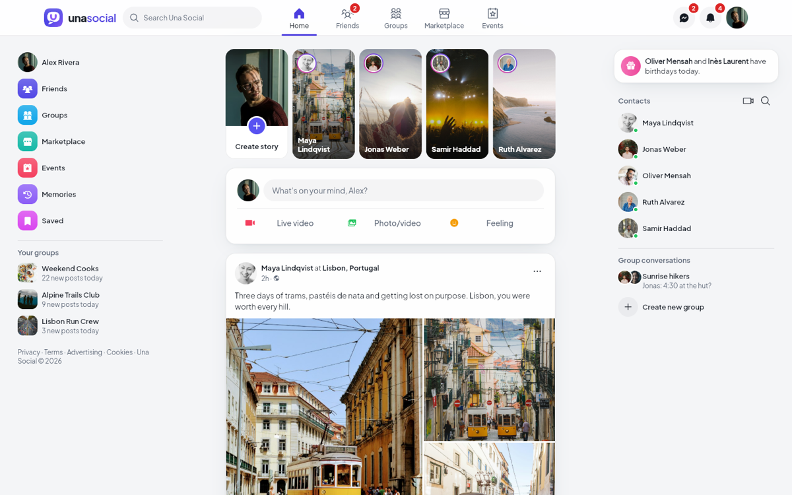
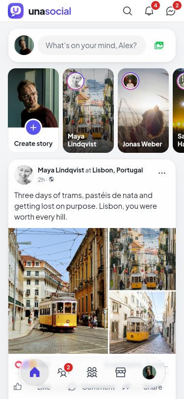

# Una Social

A fictional social network — a feed with stories, reactions and comments,
friends, groups, events, a marketplace and a messenger — built entirely
from the widgets of [una](https://github.com/vlidholt/una), a Flutter UI
package.

**Try it:** <https://vlidholt.github.io/una_social/>

<p>
  
  
</p>

It is one of the example apps that show what una looks like in a real
product. Everything adapts: a desktop gets a top bar with the
destinations, three columns on Home and side-by-side messages; a phone
gets a floating bottom bar, touch-first rows and pages that slide in. On
an iPhone, iPad or Mac the bars, menus and sheets are Liquid Glass; the
Menu tab (phone) and the account menu (desktop) turn it off to show what
every other platform gets, and switch to dark mode.

## What is in it

- **Home** — stories (tap one for the full-screen viewer), a composer with
  photos and feelings, and posts with photo grids, reactions (hover or
  long-press Like), comments, sharing and a menu to save or hide.
- **Friends** — requests to confirm, people you may know, all friends.
- **Groups** and **Events** — join groups, read their posts, answer events.
- **Marketplace** — listings by category, saved with a heart, each with a
  page and "Message seller".
- **Messages** — conversations that answer back, with typing indicators.
- **Notifications**, **profiles** with a tall cover photo, **search** and
  **settings**.

## The look

The package's default style (Fluid) on its own colours:
`ColorScheme.fromSeed` with an electric indigo (`#5046E5`) and slate
greys, set in Plus Jakarta Sans. The logo is drawn in code
(`lib/widgets/logo.dart`) and the web icons are rendered from it
(`UPDATE_APP_ICONS=1 flutter test test/app_icons_test.dart`).

The photographs are from Unsplash; see
[assets/images/README.md](assets/images/README.md) for the credits. Every
person, group and business in the app is fictional.

## Running it

```bash
flutter pub get
flutter run -d chrome
```

una is not on pub.dev: `pubspec.yaml` takes it from git and
`pubspec.lock` pins the commit. To work against a local checkout of una,
add a `pubspec_overrides.yaml` (it is gitignored):

```yaml
dependency_overrides:
  una:
    path: ../una
```

## License

MIT; see [LICENSE](LICENSE).
